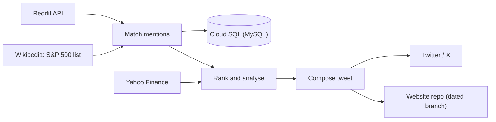

# The Reddit Street Journal

[](https://github.com/tuckeryazdani/Reddit_Street_Journal/actions/workflows/ci.yml)


A data pipeline that finds the stock r/wallstreetbets is talking about most, stores every
mention in a cloud database, and posts a summary to Twitter as
[@WSB_Journal](https://x.com/WSB_Journal).

## What a run does



1. **Extract.** Read every comment on the subreddit's 100 hottest posts through the Reddit API.
2. **Match.** Find the S&P 500 companies each comment mentions, by name, alias, ticker or
   cashtag. The constituent list is scraped from Wikipedia and cached for a week.
3. **Load.** Append the new mentions to a MySQL table on Google Cloud SQL. The load is
   idempotent, so re-running the job never double-counts a comment.
4. **Analyse.** Take the most-mentioned company and pull its price history from Yahoo Finance:
   the change over the last 7 trading days, and how it has historically performed in each season.
5. **Publish.** Post the summary as a tweet and, optionally, push it to a static website's git
   repository on a dated branch, ready for a pull request.

As a side feature, the bot answers tweets that mention it, in character, using an OpenAI model.

### Example

Output of `python -m reddit_street_journal --dry-run` on 22 November 2026:

```text
INFO reddit_street_journal.pipeline: Found 1565 mentions of 101 companies. Top 5:
     {'nvidia': 620, 'google': 107, 'apple': 76, 'oracle': 69, 'tesla': 63}
INFO reddit_street_journal.pipeline: Dry run: skipped the database load and all publishing

Top trending stock on r/wallstreetbets
(2026-11-22)

Stock: Nvidia (NVDA)
620 mentions

-$40.66 (-24.47%) over the past 7 trading days.
Historically performs better than its average in the Fall.
Next season (Winter) tends to be stronger than Fall.
```

## Engineering notes

### Matching mentions without counting noise

The first version of the matcher was a substring test: `if "meta" in comment`. An audit of one
run's output showed what that costs. Of 569 recorded mentions, 138 (24%) were false positives:
"metals" counted as Meta, "intelligence" as Intel, "kubernetes" as Uber. It changed the answer,
too. Meta was recorded as the most-mentioned stock with 129 mentions; only 45 were real, and
Nvidia, with 98, was the actual leader.

The matcher in [`mentions.py`](reddit_street_journal/mentions.py) now matches whole words only,
and asks for more evidence the more ambiguous a token is:

| Written as | Counts when | Why |
| --- | --- | --- |
| `$TSLA` | always, in any case | A cashtag is explicit. |
| `TSLA` | upper case, 3+ letters, not a common word | `ALL`, `NOW` and `COST` are tickers, and also words people shout. |
| `tesla` | whole word, in any case | Company names and aliases ("facebook" resolves to Meta). |

Formal names from the index are cleaned first ("Tesla, Inc." becomes "tesla"), and names that
are also everyday words ("target", "block") are matched by ticker only. The false positives
from the audit are now [test cases](tests/test_mentions.py).

### Idempotent loads

Every run re-reads the subreddit's hot posts, so most comments have been seen before. A plain
append would store them again each time. [`storage.py`](reddit_street_journal/storage.py)
anti-joins each batch against the rows already in the table, inside one transaction, and
inserts only what is new. The job can be re-run after a failure, or scheduled more often,
without inflating the counts.

### Failing loudly, degrading gracefully

- **Configuration is validated before anything runs.** A missing credential stops the job
  with one message naming every missing variable, not a stack trace halfway through.
- **A failed Wikipedia scrape falls back to the last cached list**, and a scrape that returns
  far fewer than 500 rows is treated as a failure instead of silently shrinking the universe.
- **Publishing steps are independent.** A Twitter outage does not stop the website update;
  the run still exits non-zero so the scheduler sees the failure.
- **Price data is optional.** If Yahoo Finance is down the tweet goes out without the price
  lines, and never reports a missing price as a change of zero.

### Built to be tested

`--dry-run` runs the whole pipeline against live Reddit and Yahoo data and prints the tweet,
but writes nothing: no database load, no tweet, no git push. It needs only Reddit credentials,
so it is the quickest way to try the project.

The test suite covers the matching rules, the load, the tweet text and the orchestration, and
runs offline in a few seconds. External services are replaced with fakes; SQLite stands in for
MySQL, and the website publisher is exercised against a real throwaway git repository.

## Getting started

Requires Python 3.11 or newer and a Reddit "script" app
([create one here](https://www.reddit.com/prefs/apps)).

```bash
git clone https://github.com/tuckeryazdani/Reddit_Street_Journal.git
cd Reddit_Street_Journal

python -m venv .venv
source .venv/bin/activate        # Windows: .venv\Scripts\activate
pip install -r requirements-dev.txt

cp .env.example .env             # then fill in at least the REDDIT_* values
python -m reddit_street_journal --dry-run
```

Options:

```text
--dry-run            read from Reddit and print the tweet, but store and publish nothing
--subreddit NAME     subreddit to scan (default: wallstreetbets)
--limit N            number of hot posts to scan (default: 100)
```

A live run (no `--dry-run`) also needs the Twitter and Cloud SQL settings described in
[`.env.example`](.env.example).

### Running in Docker

```bash
docker build -t reddit-street-journal .

# Dry run
docker run --rm --env-file .env -v "$PWD/state:/app/state" reddit-street-journal --dry-run

# Live run, with a Google service-account key mounted read-only
docker run --rm --env-file .env \
  -v "$PWD/state:/app/state" \
  -v "/path/to/service-account.json:/secrets/gcp.json:ro" \
  -e GOOGLE_APPLICATION_CREDENTIALS=/secrets/gcp.json \
  reddit-street-journal
```

No credentials are built into the image; they are supplied at run time. The `state` volume
keeps the ticker cache and the record of tweets already replied to between runs. The container
runs once and exits, so any scheduler can drive it.

## Development

```bash
pytest                  # run the tests
ruff check .            # lint
ruff format .           # format
```

GitHub Actions runs all three on every push and pull request, on Python 3.11 and 3.13.

## Project layout

```text
reddit_street_journal/
  __main__.py        command-line entry point
  config.py          settings from environment variables, validated up front
  pipeline.py        orchestration: extract, load, analyse, publish
  tickers.py         S&P 500 universe: scrape, cache, name cleaning, aliases
  mentions.py        the matcher
  reddit_client.py   Reddit API (PRAW)
  storage.py         table definition and idempotent load (SQLAlchemy)
  market_data.py     Yahoo Finance prices, 7-day change, seasonal returns
  report.py          tweet text
  twitter_client.py  posting and replying (Tweepy)
  llm.py             reply generation (OpenAI)
  website.py         website update over git
tests/               one test module per source module
```

## Data model

One row per company per comment, in `reddit_mentions`:

| Column | Type | Notes |
| --- | --- | --- |
| `stock` | text | Canonical lowercase company name, e.g. `nvidia` |
| `comment_body` | text | Full comment text, kept for auditing the matcher |
| `author` | text | Reddit username |
| `created_at` | datetime | Comment time, UTC |
| `post_title` | text | Title of the post the comment was on |

## Limitations and next steps

- **S&P 500 only.** Stocks outside the index (GME, AMC) and ETFs (SPY) are not tracked.
  A broader listing source would fix this at the cost of more ambiguous tickers.
- **Mentions are counted, not scored.** A comment saying a stock is terrible counts the same
  as one saying it is great. Sentiment scoring is the natural next step.
- **Precision is favoured over recall.** Lowercase tickers (`nvda`) and one- or two-letter
  tickers without a `$` are deliberately not counted.
- **Some names stay ambiguous.** "intel" also means intelligence, and no word-level rule can
  tell "bad intel" from "bad Intel". Resolving that needs context, not a longer stop list.
- **The dedup key is `(stock, author, created_at)`.** The table does not store Reddit's comment
  id; adding it as a column with a unique index would move deduplication into the database.
